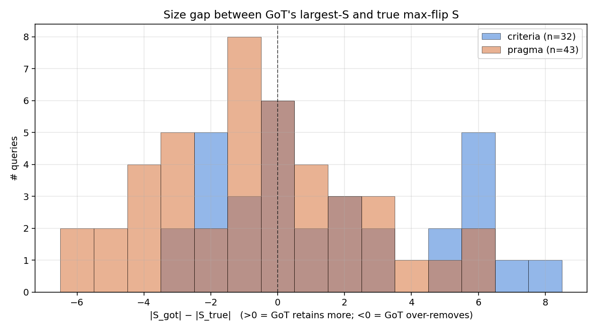
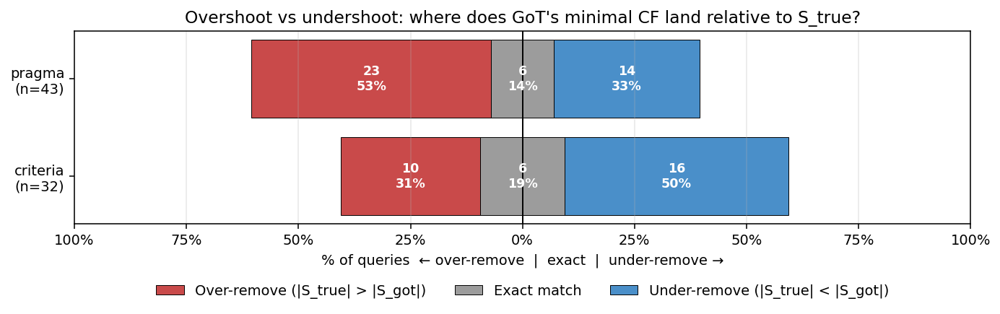

# GoT min-CF evaluation

All tables use lattice-complete queries whose graph-baseline agrees with the
lattice's full-set top-1, and where GoT produced a proposal. Source:
`graph_eval_{criteria,pragma}_cf_removal.json`.

- criteria: n = 32
- pragma:   n = 43

Excluded:
- criteria: 4 singleton-only lattices (`51620, 51790, 52008, 52040`) and 2 baseline mismatches (`51880, 52305`).
- pragma:   6 singleton-only lattices (`51620, 51691, 51693, 51726, 51928, 52416`) and 3 baseline mismatches (`51845, 52305, 52406`).

## 1. Flip success rate

Fraction of queries where GoT's proposed minimal counterfactual (largest retained-concept set `S`) actually flips the lattice top-1 away from the baseline answer.

| variant  | valid CFs | total | flip success |
|----------|----------:|------:|-------------:|
| criteria |         6 |    32 |        18.8% |
| pragma   |        20 |    43 |        46.5% |

Source field: `got_min.flip_success`.

## 2. Size mismatch: overshoot vs undershoot

Comparing `|S_got|` to the true `max_retain_size`:

- **undershot** = `|S_got| > |S_true|`: GoT removed too *few* concepts (not aggressive enough).
- **overshot**  = `|S_got| < |S_true|`: GoT removed too *many* concepts (over-aggressive).

| variant  | matched         | undershot (too few removed) | overshot (too many removed) |
|----------|----------------:|----------------------------:|----------------------------:|
| criteria |  6/32 = 18.8%   |          16/32 = 50.0%      |          10/32 = 31.2%      |
| pragma   |  6/43 = 14.0%   |          14/43 = 32.6%      |          23/43 = 53.5%      |

Criteria tends to leave `S_got` too large; pragma tends to trim past the true minimum.

## 3. Overshoot: is `S_got` a subset of a true min-CF?

For overshot cases, we check whether `S_got ⊆ S_true` for some true minimal-CF `S_true`. Equivalently: did GoT remove a superset of what a true minimal removes (correct direction, just over-aggressive)?

| variant  | overshot | S_got ⊆ some true min-CF | wrong direction         |
|----------|---------:|-------------------------:|------------------------:|
| criteria |       10 |          6/10 = 60.0%    |         4/10 = 40.0%    |
| pragma   |       23 |         13/23 = 56.5%    |        10/23 = 43.5%    |

Interpretation:
- ~57–60% of overshoots are "correct direction, went too far" — adding some removed concepts back would recover a true minimal CF.
- ~40–43% took a wrong turn — GoT removed at least one concept that no true minimal CF removes, so no amount of add-backs alone reaches the true minimum.

Wrong-direction qids:
- criteria: 51811, 52215, 52280, 52406
- pragma: 51730, 51734, 51790, 51881, 51891, 51894, 51895, 52008, 52109, 52280

## 4. Undershoot: can we reach a true min-CF by removing more concepts?

For undershot cases, we check whether some true minimal-CF `S_true ⊆ S_got` — meaning GoT can reach a true minimum by removing exactly `k = |S_got| − |S_true|` more concepts.

| variant  | undershot | can reach a true MIN by removing k more | can reach ANY flip by removing more |
|----------|----------:|----------------------------------------:|------------------------------------:|
| criteria |        16 |                12/16 = 75.0%            |             14/16 = 87.5%           |
| pragma   |        14 |                10/14 = 71.4%            |            14/14 = 100.0%           |

Distribution of `k` (additional concepts to remove) for the reachable-true-min cases:

| variant           | k=1 | 2 | 3 | 4 | 5 | 6 | 7 | 8 |
|-------------------|----:|--:|--:|--:|--:|--:|--:|--:|
| criteria (n=12)   |   1 | 2 | 2 | 0 | 2 | 3 | 1 | 1 |
| pragma (n=10)     |   3 | 2 | 2 | 1 | 1 | 1 | 0 | 0 |

Pragma tends to need fewer additional removals (median ~2.5 vs criteria ~5).

Wrong-turn undershoots (cannot reach a true min by only further removal — `S_got` is missing at least one removal that every true min-CF makes):
- criteria: 514495, 51816, 51843, 52109 (51843 and 52109 can't reach any flip by further removal)
- pragma: 514495, 51785, 51923, 548857 (all reach some flip, just not a true minimum)

## 5. Distance to true counterfactual (size gap)

Distribution of `|S_got| − |S_true|` across all lattice-complete queries. Positive values = GoT under-removed (kept too many concepts); negative = GoT over-removed (dropped too many); zero = size match.

For a combined overshoot / match / undershoot view:

Shape summary:
- **Pragma** clusters near zero and just left of it (median gap −1) — most misses are mild over-removals.
- **Criteria** leans right with a fatter right tail — a peak at 0 and a long tail out to +8, indicating a subgroup where GoT barely removed anything.
- Criteria has the widest right tail (up to +8); pragma has the widest left tail (down to −6).

## Interpretation

GoT is cheap — one LLM pass produces the graph, versus BFS enumeration over the `2^n` lattice for the ground truth. The evaluation shows what that cheapness costs:

**1. Validity is low.** Only 18.8% (criteria) / 46.5% (pragma) of GoT's proposed minimal CFs actually flip the top-1 in the lattice. More than half the time, GoT's "counterfactual" is not one. Pragma is meaningfully better at validity — over 2× criteria — but still misses the majority.

**2. Even when valid, it's rarely minimal.** Only 14–19% of proposals hit the true minimal size. Errors are large in absolute terms — gaps of ±6 to ±8 out of ~10 atoms occur. Criteria and pragma also fail in *opposite* ways: criteria systematically under-removes (leaves `S_got` too large, median undershoot ~5 levels), pragma systematically over-removes (median overshoot ~2 levels — smaller in magnitude).

**3. But direction is usually right.** ~57–75% of misses in either direction contain / are contained by a true minimal CF — GoT identifies roughly the right concept subset, it just picks the wrong number of concepts to include. That's a calibration failure, not a search failure. The wrong-direction rate (35–45%) is the harder problem: GoT removed a concept no true min-CF removes, so local search alone cannot recover.

**Takeaway.** GoT on its own is not a reliable minimal-CF finder — the size distributions are wide and validity is low. But since it's directionally correct most of the time and much cheaper than lattice BFS, it's a plausible **seed** for a hybrid pipeline: use GoT's `S_got` as a starting point, then run a small local search (add-back a few concepts on overshoot, remove a few more on undershoot) to close the calibration gap. That could recover most of the reachable-true-min cases (~72–75% of undershoots, ~57–60% of overshoots) at a small fraction of the BFS cost.

The remaining wrong-direction cases (~28–43% of misses) are the ones where GoT is fundamentally confused about which concepts drive the flip — those need a different fix (better prompt, better graph construction, or fallback to lattice search).
