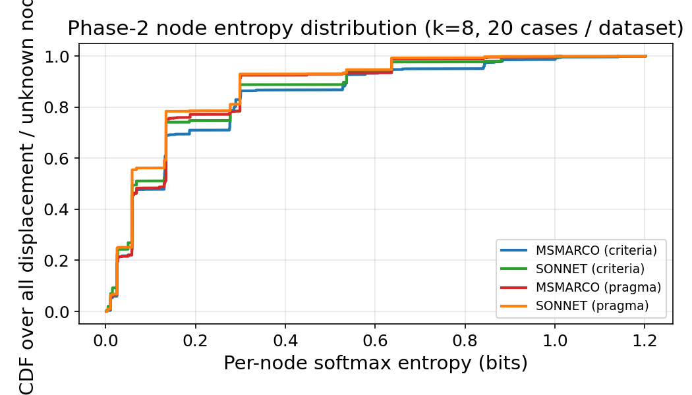
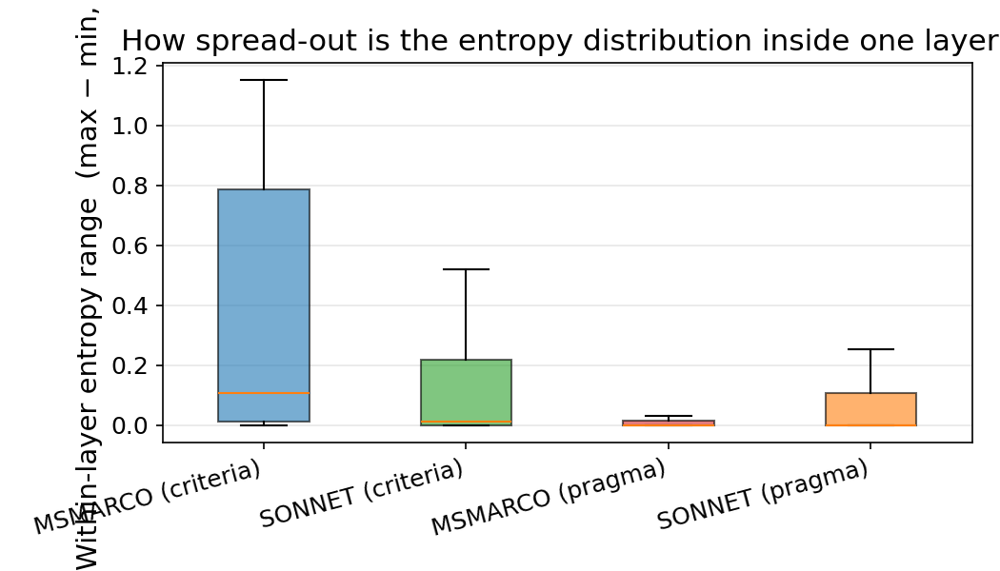
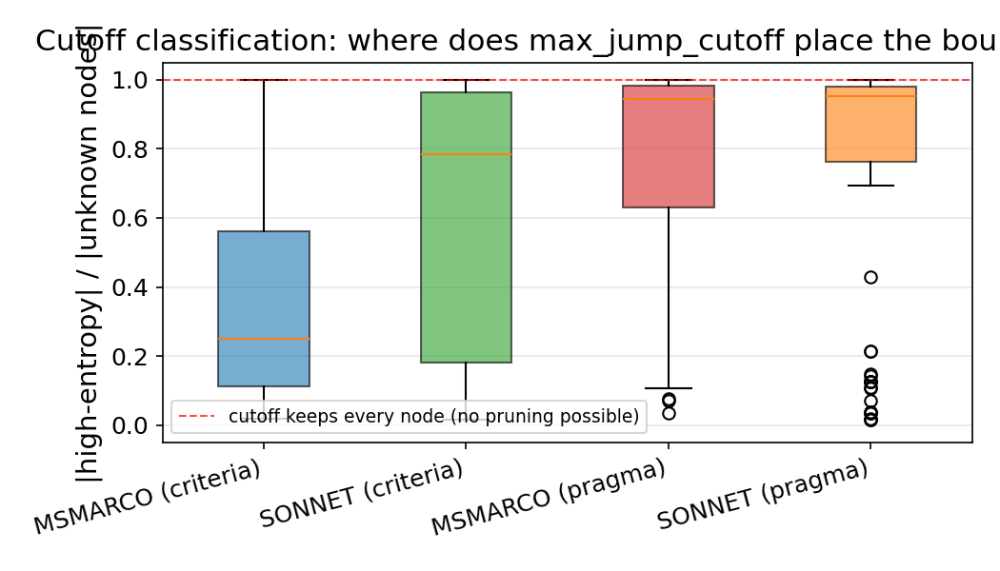
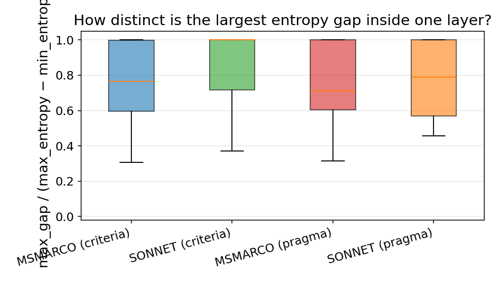
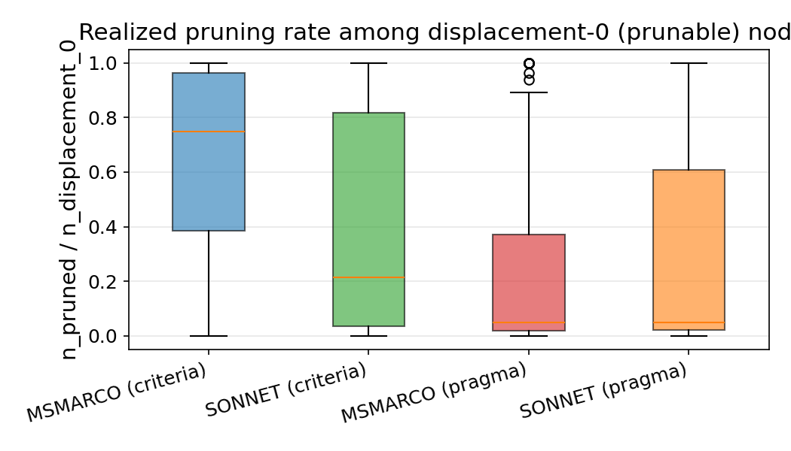

# Why `max_jump_cutoff` fails on pragma datasets

**Date:** 2026-06-21
**Code under test:** `search/rank.py:era_search` (v1) + `search/heuristics.py:{softmax_entropy, max_jump_cutoff}`
**Datasets:** k=8 sub-lattices, 20 cases per dataset, sampled SEED=42
**Instrumentation:** [`reports/era_pragma_pruning/instrument.py`](./instrument.py)
**Analysis + figures:** [`reports/era_pragma_pruning/analyze.py`](./analyze.py)
**Raw layer rows:** [`data/layers.jsonl`](./data/layers.jsonl) (349 rows)

## TL;DR

`max_jump_cutoff` doesn't fully fail on pragma — it limps. Pragma Phase-2 layers prune **a median of 4.8% of prunable nodes**, vs **21–75% on criteria datasets**. The mechanism is a two-stage collapse:

1. **Borda aggregation produces near-identical softmax-entropy values across every node in a pragma layer.** Median within-layer entropy range is **exactly 0.0000 bits** on both pragma datasets (vs ~0.01–0.10 bits on criteria — figure 2).
2. **When entropies tie, `max_jump_cutoff`'s tie-break selects the *last* gap**, which puts ~95% of the layer on the high-entropy side — and the pruning rule `(displacement < 1 AND key not in high_entropy_keys)` becomes vacuous (figure 3, cutoff median = 0.945 / 0.952 on pragma).

Net effect: ERA on pragma is barely better than BFS at k=10 (e.g. SONNET-pragma: 295 calls vs BFS 329, 10% saved) because the score-based confidence layer is doing almost no work.

> **Data caveat found during the investigation.** `score_proxy()` in both pragma runners (`scripts/pragma/{msmarco,sonnet}/run_subsample.py`) was dropping `pruned_nodes` from the per-case dict. That's why the earlier cost-table showed `pruned=0` everywhere on pragma — the field was simply absent. Fixed in this branch. Findings here come from a fresh instrumented run that bypasses `score_proxy`.

## Mechanism

`era_search` Phase 2 pruning rule, transcribed (`search/rank.py:338-347`):

```python
entropy_inputs = [(key, ent) for _, key, _, ent in unknown_nodes]
high_entropy_keys = set(cutoff_fn(entropy_inputs, len(unknown_nodes)))

candidates = [
    (subset, key, displacement, ent)
    for subset, key, displacement, ent in unknown_nodes
    if not (displacement < 1 and key not in high_entropy_keys)
]
pruned_nodes += len(unknown_nodes) - len(candidates)
```

A node is pruned iff **both**:
- `displacement < 1` — its estimated top-1 is still the baseline answer (no flip suspected).
- `key not in high_entropy_keys` — its entropy is on the *low* side of `max_jump_cutoff`'s decision.

Both predicates are simultaneously satisfied on criteria data but rarely on pragma data. The first one fires plenty on pragma (3,276 disp-0 nodes on MSMARCO-pragma, 2,266 on SONNET-pragma — see `data/summary.json`). It's the second one that fails.

`max_jump_cutoff` (`search/heuristics.py:69-89`):

```python
sorted_nodes = sorted(nodes_with_entropy, key=lambda x: x[1], reverse=True)
gaps = [sorted_nodes[i][1] - sorted_nodes[i + 1][1]
        for i in range(len(sorted_nodes) - 1)]
max_gap_idx = max(range(len(gaps)), key=lambda i: (gaps[i], i))   # ← tie-break = last index
selected = sorted_nodes[:max_gap_idx + 1]
```

The tie-break `(gaps[i], i)` says: when two gaps are equal, prefer the larger index (the gap deeper in the sorted list). Comment in the code: *"so fewer nodes are excluded from the high-entropy tier"*. On criteria data this is a reasonable bias. On pragma data with universally-equal gaps it degenerates to "select everyone."

## Evidence

### Per-dataset summary (k=8, 20 cases each)

| Metric | MSMARCO crit | SONNET crit | MSMARCO prag | SONNET prag |
|---|---:|---:|---:|---:|
| Phase-2 layers visited | 70 | 91 | 108 | 80 |
| Total unknowns scored | 2,361 | 3,184 | 3,423 | 2,401 |
| Total displacement-0 nodes | 1,989 | 3,119 | **3,276** | **2,266** |
| Total pruned | 1,334 | 1,477 | **717** | **692** |
| **Pruning rate (median over layers)** | **0.750** | **0.214** | **0.048** | **0.048** |
| Pruning rate (mean over layers) | 0.658 | 0.402 | 0.247 | 0.283 |
| **Within-layer entropy range (median, bits)** | **0.1052** | **0.0119** | **0.0000** | **0.0000** |
| Cutoff fraction kept (median) | 0.250 | 0.786 | **0.945** | **0.952** |
| Layers where cutoff kept **every** node | 1.4% | 5.5% | **11.1%** | **7.5%** |
| Per-node entropy (median, bits) | 0.130 | 0.068 | 0.131 | 0.059 |

Pragma's pruning rate is the lowest, the within-layer entropy range is the smallest, and the cutoff classifies the most nodes as "high entropy". The pattern is consistent across both pragma datasets — this is a property of the pragma sub-lattice structure, not a per-dataset fluke.

### Figure 1 — node-level entropy CDF



Distribution of per-node softmax-entropy values across every Phase-2 layer. Pragma and criteria distributions overlap heavily *at the global level* — the issue isn't that pragma entropy is uniformly higher or lower. The damage is at the **within-layer** scale.

### Figure 2 — within-layer entropy range



`max(entropies in layer) − min(entropies in layer)`. **Both pragma medians are exactly 0** — meaning ≥50% of pragma layers have entropies that are bit-identical across every estimated node. When this happens, `max_jump_cutoff` sees `gaps = [0, 0, 0, ...]`, the tie-break selects the last index, and `high_entropy_keys` becomes the entire layer.

Criteria medians are non-zero (MSMARCO ≈ 0.10 bits, SONNET ≈ 0.01 bits): the cutoff actually has gaps to grip onto.

### Figure 3 — cutoff classification



Fraction of each layer placed on the high-entropy (un-prunable) side of the cutoff. Pragma boxes hug 1.0; MSMARCO-criteria sits around 0.25; SONNET-criteria around 0.79. The red dashed line at 1.0 is the regime where pruning is mathematically impossible — pragma touches it in ~10% of layers.

### Figure 4 — max gap as fraction of entropy range



How "dominant" is the largest gap relative to the total entropy spread? On SONNET-criteria the median is 1.0 (one gap explains the whole spread → clean split). On pragma the median sits at ~0.71–0.79: there *is* a largest gap, but other gaps are nearly as large — the cutoff decision is hairline-thin.

### Figure 5 — realized pruning rate



`n_pruned / n_displacement_0` per layer. Pragma medians sit near zero — even when many nodes *could* be pruned (displacement=0), the cutoff classifies them as high-entropy and keeps them.

## How can the within-layer entropy range be *exactly* zero?

"Range = 0" sounds strong — it means every estimated node in the layer has bit-identical softmax entropy. The mechanism is a *cascading collapse* of singleton rankings, traced in [`trace.py`](./trace.py).

### Singleton rankings collapse to a few classes

For a representative pragma case (SONNET-pragma, qid=59, k=10):

```
Distinct singleton rankings: 3
  class A (top: Apple → Garmin → Fitbit) — 5 pragmas
  class B (top: Apple → Fitbit → Garmin) — 1 pragma
  class C (top: Garmin → Apple → Fitbit) — 4 pragmas
```

Only **3 distinct full rankings** across 10 pragmas. This is normal on pragma data: temporal / geographic / trustworthiness modulators don't always change the answer order — many pragmas leave the LLM's top-3 untouched.

### CombSUM acts as a majority filter that propagates upward

A layer-m node has m voters of size m-1, combined by CombSUM (sum of Borda scores `n - rank`). When one ranking class is plurality, its `n - rank` contributions dominate and the aggregated ranking is *bit-identical* to that class's ranking.

The trace at layer 7 of qid=59 shows the absorbing state:

```
Layer 7 (120 nodes):
  distinct entropies         = 1
  distinct score dicts       = 1
  distinct voter-ranking multisets = 1
  entropy range              = 0.000000e+00
```

Every one of 120 layer-7 nodes aggregates the **same multiset of voter rankings** (all class A). That's not coincidence — it's because by layer 6, *every estimated ranking has already become class A*. The voter inspection confirms it:

```
pragma_indices=[0,1,2,3,4,5,6]  voter_classes={A: 7}  ent=0.0105
pragma_indices=[0,1,2,3,4,5,7]  voter_classes={A: 7}  ent=0.0105
pragma_indices=[0,1,2,3,4,5,8]  voter_classes={A: 7}  ent=0.0105
... (same multiset across all 120 nodes)
```

### Why the collapse is monotonic upward

If layer m has only one distinct estimated ranking, layer m+1 must too:

- Every layer-(m+1) node has m+1 voters, each a layer-m node
- All layer-m nodes share the same ranking → all voters contribute the same Borda scores
- CombSUM is order-invariant on identical voters → all layer-(m+1) Borda dicts are identical
- Softmax is invariant to additive shifts → all entropies are bit-identical

Once the collapse happens at some layer m*, it persists for every layer above m*. The instrumented data shows this is the typical regime on pragma: 50 of 80 sampled sonnet-pragma layers (62.5%) have bit-identical entropies across every unknown node.

### Why this hits pragma harder than criteria

Criteria datasets pass two filters that pragma data fails:

1. **More distinct singleton rankings.** Criteria slice the answer space directly — each criterion typically surfaces a *different* top-1 answer, so singleton rankings are diverse. Pragma singletons reuse a handful of rankings.
2. **No dominant plurality class.** Even when criteria singletons share some rankings, the class sizes are more balanced — CombSUM can't elect a winner that swallows the layer.

This is also why `_combsum`'s order-invariance helps in criteria-land (deterministic, ties broken alphabetically) and hurts in pragma-land (the order doesn't matter because every voter says the same thing).

## Fixes worth trying (none implemented in this report)

1. **Min-gap floor**: in `max_jump_cutoff`, if `max(gaps) < ε * (max_entropy - min_entropy)` (or `< ε` absolute), refuse to split and return an empty high-entropy set instead of the last-index tie-break. This converts "tied gaps everywhere" from "prune nothing" into "prune everything that's displacement-0". Trade-off: aggressive on near-uniform layers; may over-prune.
2. **Tie-break direction**: flip the tie-break to prefer the *earliest* index when gaps are tied. Pragma layers would then prune all-but-one node when entropies tie, instead of pruning none. Risk symmetric: over-prunes on degenerate layers.
3. **Augment the predicate**: also gate pruning by `score_margin` (as in v2). On pragma the displacement-0 nodes have small Borda margins → margin alone would correctly identify *which* of the tied-entropy nodes are still risky.
4. **Use a different entropy function**: `weighted_entropy` (already in `search/heuristics.py`) weights probabilities by rank — it might produce more variation across estimated rankings whose top-1 is identical but tail differs. This was part of the entropy ablation results and is worth re-checking against pragma sub-lattices specifically.

Any of (1), (3), (4) is testable by replacing `cutoff_fn` / `entropy_fn` in the existing `era_search` call site — no algorithmic changes to v1 required. The next step would be to run the entropy ablation (`run_entropy_ablation.py`) on pragma at `pct_10` and check whether `weighted_entropy` lifts pruning rate without hurting accuracy.
